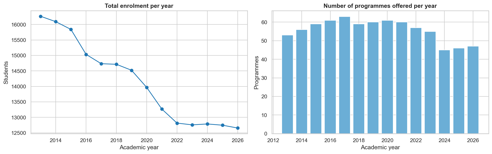
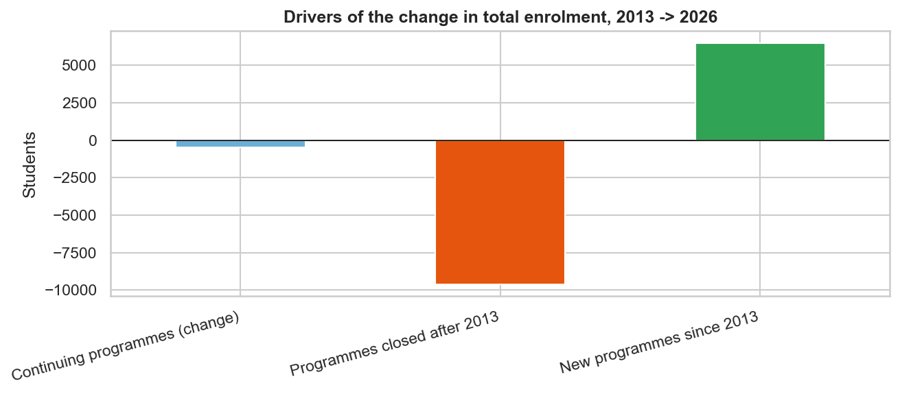
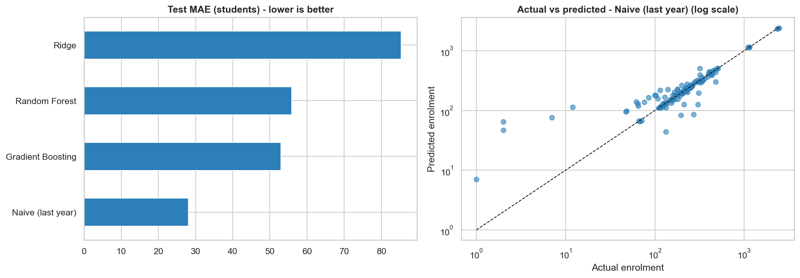
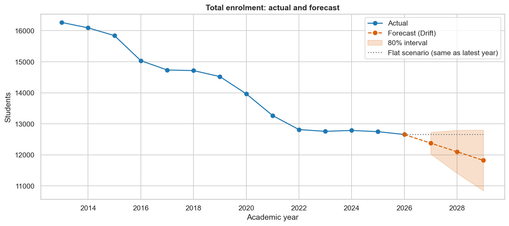

# 📊 Course Enrollment Demand and Forecasting

> **Business Analytics Project | CSE (Data Science)**
> Author: Sarnava Pal
 
## 📌 Project Overview

This project analyzes historical course enrollment data to understand enrollment demand, identify trends and patterns, and forecast future enrollment.

It applies **Business Analytics** and **Predictive Analytics** techniques to turn historical enrollment data into meaningful insights that support academic planning and resource allocation (intake targets, staffing, labs and rooms).

The complete workflow, from data cleaning to forecasts and recommendations, is implemented in **Python** in a single Jupyter notebook.

## 🎯 Objectives

- 📈 Analyze historical course enrollment trends.
- 🔍 Identify patterns in course demand.
- 📊 Compare enrollment across programmes, schools and time periods.
- 🔮 Forecast future enrollment demand (2027–2029).
- 💡 Generate actionable insights and recommendations for academic and resource planning.

## ❓ Key Business Question

> Can historical course enrollment data be used to predict future course enrollment demand?

**Answer:** Yes. Enrollment is highly persistent from one year to the next (correlation with the previous year ≈ 0.85), so past enrollment is a strong predictor of future enrollment. For large, established programmes, "same as last year" is already hard to beat; machine-learning models help mainly for young or ramping-up programmes. All forecasts are reported with uncertainty ranges.

---

## 🗂️ Dataset

**File:** `Dataset Course Enrollment.csv`
**Size:** 1,563 rows · academic years **2013–2026** · 94 diploma programmes · 10 schools

| Column | Description |
|---|---|
| `academic_year` | Year of intake (2013–2026) |
| `semester` | Always `S1`, so the data is **annual** |
| `school` | School offering the programme (names change over time) |
| `jae_course_code` | Programme code (missing for some early rows) |
| `course_name` | Diploma programme name (used as the programme identifier) |
| `gender` | Student gender (`FEMALE/MALE` and `F/M` labels are standardised) |
| `enrolment` | Number of students enrolled (**target variable**) |

### 🧹 Data preparation

| Check | Finding | Action |
|---|---|---|
| Missing values | 46 missing `jae_course_code` (2013–2018) | Left as is; `course_name` (complete) is the identifier |
| Duplicates | None (checked full rows and year + programme + gender keys) | No action needed |
| Gender labels | `FEMALE`, `MALE`, `F`, `M` | Standardised to `F` / `M` |
| Zero-enrolment rows | 25 rows, each a single-gender zero in a running programme | Kept (real data) |
| School re-organisations | School names change in 2020–2021 | Analysis at programme level, each programme mapped to its latest school |

---

## 🔬 Methodology

```
📥 Data Collection
       ↓
🧹 Data Preparation & Cleaning
       ↓
🔍 Exploratory Data Analysis
       ↓
📊 Descriptive Analytics
       ↓
🔎 Diagnostic Analytics
       ↓
🔮 Predictive Analytics
       ↓
📈 Forecasting
       ↓
💡 Business Insights
       ↓
🎯 Recommendations
```

| Stage | What is done in the notebook |
|---|---|
| **EDA & Descriptive** | Total trend, programmes per year, school × year heatmap, top programmes, year-on-year growth, biggest gainers and losers, gender share |
| **Diagnostic** | Decomposition of the decline (continuing vs closed vs new programmes), concentration of enrollment, trend regression, correlation with last year, Kruskal-Wallis test across schools |
| **Predictive** | One-year-ahead prediction per programme (target = growth ratio). Naive baseline vs Ridge, Random Forest and Gradient Boosting. **Time-based split:** train 2013–2023, test 2024–2026. Metrics: MAE, RMSE, MAPE, WAPE, median APE |
| **Forecasting** | Naive, mean of last 3, drift, drift (last 3 yrs) and damped Holt, **selected by back-testing**; 80% intervals from back-test errors; forecasts for 2027–2029 for total enrollment, each programme and each school |
| **Insights & Recommendations** | Rule-based action list per programme (Grow / Maintain / Review) with adjustable thresholds |

---

## 📈 Key Findings

### 1. Enrollment fell 22%, but has levelled off
Total enrollment fell from **16,266 (2013)** to **12,656 (2026)**. The decline was steady until 2022 and has been almost flat since (2023–2026 trend is not statistically significant).



### 2. The decline was driven by programme closures
| Group | Change in students |
|---|---|
| Continuing programmes (16) | −474 |
| Programmes closed after 2013 (37) | −9,611 |
| New programmes since 2013 (31) | +6,475 |
| **Net change** | **−3,610** |

*(A renamed or merged programme counts as one closure plus one new programme, so the counts are a guide rather than exact closures.)*



### 3. Demand is concentrated
The 3 largest programmes held **27.4%** of students in 2013 and **32.0%** in 2026. **Diploma in Nursing** alone is about **19.5%** of 2026 enrollment (2,463 of 12,656) and 15.9% of all enrollments over the period.

### 4. Gender balance is stable
The female share stayed between **49.4% and 51.6%** throughout, so gender does not explain the decline.

### 5. Prediction results (test years 2024–2026)

| Model | MAE (students) | WAPE % |
|---|---|---|
| **Naive (same as last year)** | **28.1** | **9.8** |
| Gradient Boosting | 51.8 | 18.1 |
| Random Forest | 55.8 | 19.5 |
| Ridge | 85.3 | 29.8 |

For large, established programmes the naive baseline is hardest to beat. The models do better for **young programmes** (WAPE roughly 16–22% vs 35% for naive), but only 13 such test rows exist, so this is indicative, not conclusive.



### 6. Forecast, 2027–2029

| Year | Forecast (drift, "decline continues") | Flat scenario ("stays as 2026") |
|---|---|---|
| 2027 | ≈ 12,378 | 12,656 |
| 2028 | ≈ 12,101 | 12,656 |
| 2029 | ≈ 11,823 (80% range 10,844–12,802) | 12,656 |

Drift won the back-test but extends the long-run decline, while enrollment has been flat since 2022. Treat the two columns as a **downside case and a stable case**; the true value most likely lies between them.



At programme level (29 programmes with 8+ continuous years, covering ≈ 70% of 2026 enrollment) the back-test favours "same as last year", so programme forecasts are flat with 80% intervals (about ±9% one year ahead, ±31% three years ahead). A separate **trend scenario** ("the last 3 years' average change continues") is used as an early-warning signal for the recommendations.

---

## 🎯 Recommendations

1. **Plan capacity from the forecast tables** in `outputs/`, not from last year alone.
2. **Act on flagged programmes:** smaller intake or consolidation for *Review* programmes (trend fall ≥ 10%, e.g. Chemical & Pharmaceutical Technology, Common Engineering Programme); extra capacity for *Grow* programmes (trend rise ≥ 5%, e.g. Business & Financial Technology, Cybersecurity & Digital Forensics, Information Technology).
3. **Monitor concentration risk** in the largest programmes (Nursing, Business Management) every year.
4. **Treat new and closing programmes separately:** they have too little history for statistical forecasts, so plan them from market demand and pilot intakes.
5. **Refresh yearly:** add the new year's data, re-run the notebook and check that the back-test still supports the chosen method.

## ⚠️ Limitations

- Only **14 annual observations** per programme, so simple, validated methods are used instead of deep learning.
- Data is annual (`S1` only): no within-year seasonality or term-level forecasts.
- School re-organisations make school-level history incomparable; analysis is at programme level.
- No external drivers (school-leaver population, fees, job market, policy) are in the data, so sudden shocks cannot be predicted.
- Prediction intervals come from a small number of back-test windows and are approximate.
- Programme closures and renamings cannot be told apart from the data alone.

---

## 📁 Repository Structure

```
.
├── README.md
├── requirements.txt
├── Dataset Course Enrollment.csv
├── Course_Enrollment_Demand_and_Forecasting.ipynb   # full analysis (replaces the .Rmd)
└── outputs/                                         # created when the notebook runs
    ├── 01_total_and_programmes.png
    ├── 02_school_year_heatmap.png
    ├── 03_top_programmes_distribution.png
    ├── 04_female_share.png
    ├── 05_decline_drivers.png
    ├── 06_model_comparison.png
    ├── 07_feature_importance.png
    ├── 08_total_forecast.png
    ├── 09_programme_forecasts.png
    ├── forecast_total_enrolment.csv
    ├── forecast_by_programme.csv
    ├── forecast_by_programme_wide.csv
    └── recommendations.csv

## ▶️ How to Run

```bash
# 1. clone the repository
git clone https://github.com/sarnavapal98-beep/Course_Enrollment_Demand_and_Forecasting_1.git
cd Course_Enrollment_Demand_and_Forecasting_1

# 2. install dependencies (Python 3.9+)
pip install -r requirements.txt

# 3. open the notebook and run all cells (Kernel → Restart & Run All)
jupyter notebook Course_Enrollment_Demand_and_Forecasting.ipynb
```
## 🛠️ Tech Stack

Python · pandas · NumPy · Matplotlib · Seaborn · SciPy · scikit-learn · Jupyter

---

*Business Analytics Project, CSE (Data Science).*
